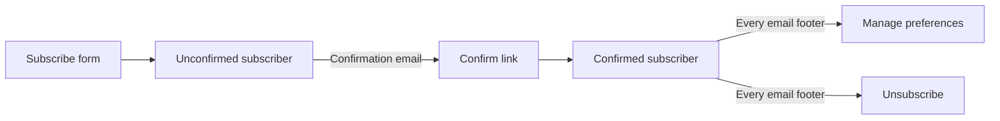

# Newsletter

The newsletter emails subscribers a weekly roundup digest and an optional daily overview of new content. Subscriptions use double opt-in, every subscriber link is protected by an HMAC token, and sending is deduplicated through a send log.

## Overview

| Email | Content | Schedule | Dedup key |
|-------|---------|----------|-----------|
| Weekly digest | The latest roundup of each section the subscriber picked | Sent once the roundups for the current week exist | Monday of the roundup week (`weekly-roundup`) |
| Daily overview | Titles and links of items added the previous local day, grouped by section | Once per day at `DailyDigestHourLocal` | The covered day (`daily-overview`) |
| Admin status report | Failure counts and subscriber stats for the last 24 hours | After the daily overview, only when something failed | The covered day (`admin-status`) |
| Confirmation and manage-link emails | A single action button | On demand | None |

Subscribers choose weekly and daily sections independently. The synthetic `all` section is not offered, and subscribing requires at least one valid section.

## Subscriber Flows

1. **Subscribe** (`/newsletter/subscribe`): The visitor enters an email, an optional display name and sections. The API creates an unconfirmed subscriber and sends a confirmation email. Nothing else is sent until the address is confirmed.
2. **Confirm** (`/newsletter/confirm`): The link in the confirmation email activates the subscription. Opening it again reports that the subscription is already confirmed.
3. **Manage** (`/newsletter/manage`): With a valid link the subscriber edits the display name and sections. Without a link the page asks for an email address and sends a management link. The response never reveals whether the address is subscribed.
4. **Unsubscribe** (`/newsletter/unsubscribe`): Opening the link shows a confirmation button without changing the subscription, so email link scanners cannot unsubscribe subscribers by loading the page. Clicking **Unsubscribe** submits a POST request. The subscriber row is kept with an `unsubscribed_at` timestamp, and the same address can subscribe again later as a new row.

Subscribing again with an address that is already confirmed does not change its preferences. Subscribers change them through the manage page instead. Re-submitting the form for an unconfirmed address updates the pending name and sections and resends the confirmation email.

## Tokens

All links in emails carry an email address and a token. Tokens are HMAC-SHA256 values over the lowercased email address, keyed with `Newsletter:UnsubscribeSecret`, and are compared in constant time.

| Token | Input | Authorizes |
|-------|-------|------------|
| Confirm token | `confirm:` + email | Confirming a pending subscription only |
| Unsubscribe token | email | Unsubscribing, and also viewing and updating preferences on the manage page |

The `confirm:` prefix provides domain separation, so a leaked unsubscribe or manage link cannot confirm a subscription. Tokens do not expire and are not stored. Rotating the secret invalidates every link already sent. When the secret is not configured, sending and all token checks fail closed (confirmation and manage links are not accepted, scheduled sends are skipped).

## Sending

`NewsletterBackgroundService` runs after startup completes. Every `CheckIntervalMinutes` it does two things: send the weekly digest if the roundups are ready, then send the daily overview if the local hour matches. See [background-services.md](background-services.md) for the shared service lifecycle and enable gates.

**Weekly digest**: The service takes the latest roundup of every section and only sends when all of them belong to the current week (Monday in Europe/Brussels). Each subscriber receives the roundups for the intersection of their weekly sections and the new roundups, ordered like the website. Subscribers are deduplicated by email address.

**Daily overview**: Runs when the local hour in `DailyDigestTimeZoneId` equals `DailyDigestHourLocal`, and covers the previous local day. It lists up to 100 items per section (excluding roundups) by ingestion time. Subscribers without new items in their sections get no email.

**Send log**: Each run writes one `newsletter_send_log` row per kind and target key. A key with status `sent` is never sent again. A `partial` or `failed` status is not final, so the next tick retries the run and can email subscribers who already received it.

**Delivery**: Email goes through Azure Communication Services using managed identity (`DefaultAzureCredential`, no connection string). A failure for one subscriber is logged and recorded in `last_daily_*` or `last_weekly_*` on the subscriber, and the run continues. `SendDelayMs` pauses between successful sends to stay under ACS rate limits. HTML templates are embedded Handlebars files compiled once at startup.

### Configuration

Options live under the `Newsletter` section ([NewsletterOptions.cs](../src/TechHub.Core/Configuration/NewsletterOptions.cs)).

| Key | Default | Purpose |
|-----|---------|---------|
| `ScheduledSendEnabled` | `false` | Environment gate for scheduled runs. `true` only in Production. |
| `CheckIntervalMinutes` | `30` | Timer interval for scheduled checks |
| `DailyDigestHourLocal` | `9` | Hour of day for the daily overview |
| `DailyDigestTimeZoneId` | `Europe/Brussels` | Time zone for the hour and the covered day. Falls back to UTC if invalid. |
| `SendDelayMs` | `200` (appsettings: `2500`) | Pause after each successful send |
| `Endpoint`, `SenderAddress` | empty | ACS endpoint and verified sender. Emails are skipped when missing. |
| `WebsiteBaseUrl` | empty | Base URL for links in emails |
| `UnsubscribeSecret` | empty | HMAC key for all tokens. Stored as a secret, not in appsettings. |
| `AdminReportEmailAddress` | set in appsettings | Recipient of the admin status report. Empty disables it. |

Scheduled runs need both `ScheduledSendEnabled` and the `Newsletter` row in `background_job_settings` (toggled on `/admin/settings`). PR previews set `ScheduledSendEnabled` to false so a restored production database never emails real subscribers. Manual admin triggers bypass both gates.

## Data Model

Tables are created by migrations 043 to 047 (see [database.md](database.md)).

| Table | Purpose |
|-------|---------|
| `newsletter_subscribers` | One row per subscription: email, display name, `is_confirmed`, `confirmed_at`, `unsubscribed_at`, `preferences` JSONB (`weeklySections`, `dailySections`), last send time and result for daily and weekly. A partial unique index on `lower(email)` where `unsubscribed_at IS NULL` allows one active row per address. |
| `newsletter_send_log` | One row per `(send_kind, target_key)` with recipient and failed counts, status (`sent`, `partial`, `failed`) and error message. Backs deduplication and the admin send log. |

## API

Public endpoints are under `/api/newsletter`. Admin endpoints are under `/api/admin/newsletter` and require the `AdminOnly` policy (see [admin-authentication.md](admin-authentication.md)). Inputs are sanitized and emails validated with `MailAddress`.

| Endpoint | Auth | Success | Errors |
|----------|------|---------|--------|
| `GET /api/newsletter/sections` | Public | `200` with sections | - |
| `POST /api/newsletter/subscribe` | Public | `200` (`needsConfirmation` flag) | `400` invalid email, no valid section |
| `GET /api/newsletter/confirm?email&token` | Token | `200` confirmed or already confirmed | `400` missing or invalid token |
| `POST /api/newsletter/unsubscribe` | Token | `200` | `400` missing fields, invalid token, secret not configured. `404` no active subscription |
| `POST /api/newsletter/manage/request?email` | Public | `200` always for valid email | `400` invalid email |
| `GET /api/newsletter/manage?email&token` | Token | `200` with preferences | `400` missing fields. `404` unknown subscriber or invalid token |
| `PUT /api/newsletter/manage` | Token | `200` | `400` missing fields or no valid section. `404` unknown subscriber or invalid token |
| `GET /api/admin/newsletter/subscribers` | Admin | `200` (`page`, `pageSize` max 500, `search`, `confirmed`) | - |
| `PUT /api/admin/newsletter/subscribers/{id}` | Admin | `200` | `404` |
| `DELETE /api/admin/newsletter/subscribers/{id}` | Admin | `200` (hard delete) | `404` |
| `GET /api/admin/newsletter/send-log?count` | Admin | `200` (max 500) | - |
| `POST /api/admin/newsletter/trigger?kind` | Admin | `202`. `kind` is `roundup` (default) or `daily` | - |
| `POST /api/admin/newsletter/test-send?email&sections&kind` | Admin | `202`. `kind` is `weekly` (default) or `daily` | `400` invalid email |

Manual triggers run asynchronously on the background service. A manual daily trigger skips the hour check, and a manual weekly trigger still requires the roundups to match the current week. Both respect the send log, so a target already marked `sent` is not sent again. Test sends deliver a `[Test]` email to one recipient with the latest roundup (or the previous day's items) for the chosen sections and are logged as `test-send` or `test-daily`.

## Web Pages

| Route | Purpose |
|-------|---------|
| `/newsletter/subscribe` | Subscribe form with weekly and daily section pickers |
| `/newsletter/confirm` | Confirmation result page |
| `/newsletter/manage` | Request a management link, or edit preferences when opened with a valid link |
| `/newsletter/unsubscribe` | Unsubscribe confirmation and result page |
| `/admin/newsletter` | Admin page: subscriber list with search and confirmed filter, edit and delete, test sends, send log. See [admin.md](admin.md). |

The Web app calls the API through `ITechHubApiClient`. Routing rules for these pages are in [url-routing.md](url-routing.md).

## Related Documentation

- [background-services.md](background-services.md) - Service lifecycle, enable gates and manual triggers
- [content-processing.md](content-processing.md) - How the weekly roundups are generated
- [ci-cd-pipeline.md](ci-cd-pipeline.md) and [network-architecture.md](network-architecture.md) - Newsletter secrets and ACS access
